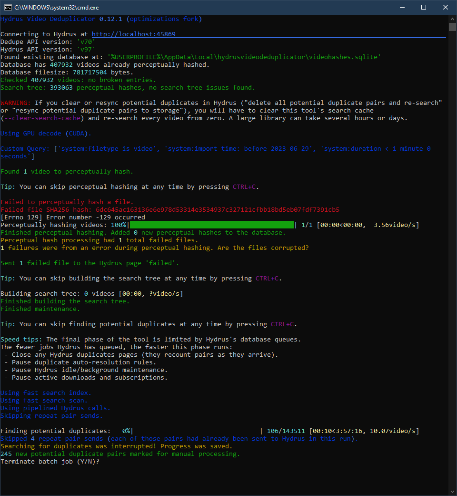

# Hydrus Video Deduplicator with optimizations

<div align="center">


</div>

This is a fork of [Hydrus Video Deduplicator](https://github.com/hydrusvideodeduplicator/hydrus-video-deduplicator). It does the same job and gives the same results, faster.

- Every speed change gives identical hashes, search tree and potential duplicate pairs.
- New features are off unless you turn them on. The exceptions: failed files go to a Hydrus page named `failed`, if you've made one, and the tool runs at below-normal priority so your PC stays usable.
- The database format is unchanged, so a database used by this fork still works with the original program.

It also adds `--relink-search-tree` to repair a damaged search tree, as reported in [issue #80](https://github.com/hydrusvideodeduplicator/hydrus-video-deduplicator/issues/80), and `--prune-orphans` to remove videos whose perceptual hash is missing, and `--dry-run` to see the pairs without sending anything to Hydrus.

This fork was vibe-coded with AI assistance and tested on a Hydrus library of about 3.5M files, with about 410k
videos perceptually hashed.

Please report problems with this fork on [this fork's issues page](https://github.com/micnorian14/hydrus-video-deduplicator/issues), not on the original project.

## Quick start

There is no .exe for this fork. You run it from source with Python. You need [Python](https://www.python.org/downloads/) 3.10 or newer and [Git](https://git-scm.com/downloads). On Windows, tick "Add python.exe to PATH" in the Python installer, and use Command Prompt (cmd.exe), not PowerShell.

```sh
git clone -b gpu-decode https://github.com/micnorian14/hydrus-video-deduplicator.git
cd hydrus-video-deduplicator
python -m venv .venv
.venv\Scripts\activate          # Linux/macOS: source .venv/bin/activate
python -m pip install -e .
```

`gpu-decode` is this fork's default branch, so a plain clone gets it. For the GUI, also run `python -m pip install -e ".[gui]"`. To update later, run `git pull` in the same folder.

To get a Hydrus API key, enable the Client API if it is not already on: in Hydrus, go to `services->edit` and give it a port (the default is 45869). Then go to `services->review` and create a new access key with `permits everything` enabled. Do not set blacklist or whitelist filters. See [Usage](./docs/usage.md) and the [Hydrus Client API docs](https://hydrusnetwork.github.io/hydrus/client_api.html) for details.

From the activated virtual environment, run:

```sh
python -m hydrusvideodeduplicator --api-key="YOUR_API_KEY" --gpu-decode auto
```

GPU decoding is off unless you add `--gpu-decode auto`. Leave it out if you do not have an NVIDIA GPU.

Or save this as a `.bat` file in the repo folder and double-click it:

```bat
@echo off
cd /d "%~dp0"
REM Remove --gpu-decode auto if you do not have an NVIDIA GPU.
.venv\Scripts\python.exe -m hydrusvideodeduplicator --api-key="YOUR_API_KEY" --gpu-decode auto --skip-repeat-pairs
pause
```

## Common problems

**`'python' is not recognized` or `'git' is not recognized`**

Reinstall Python or Git and tick "Add to PATH" (for Python, "Add python.exe to PATH"). Then open a new Command Prompt window.

**Running in PowerShell instead of cmd**

The activate command is different in PowerShell. Use Command Prompt (cmd.exe), where it is `.venv\Scripts\activate`. In PowerShell it is `.venv\Scripts\Activate.ps1`.

**Forgetting to activate the venv, or `No module named hydrusvideodeduplicator`**

Activate the virtual environment first (`.venv\Scripts\activate` in Command Prompt), or use the `.bat` above, which calls `.venv\Scripts\python.exe` directly. If you have not installed the fork yet, run `python -m pip install -e .` after activating.

**`--gpu-decode` says no CUDA device**

`--gpu-decode` is NVIDIA only. If you see `WARNING: --gpu-decode all: no CUDA device found, decoding on the CPU.` (or the same with `auto`), update your NVIDIA driver or leave the flag off. The program keeps going on the CPU.

**`--gpu-decode now needs a value`**

`--gpu-decode` on its own no longer works. Use `--gpu-decode auto` (recommended) or `--gpu-decode all`.

**GPU decode is off: missing video decoding support**

If you see `WARNING: GPU decode is off: your NVIDIA driver is missing video decoding support.`, CUDA works but NVIDIA's video decoder (NVDEC) can't be found. The program keeps going on the CPU. To fix it:

- Windows: install the latest NVIDIA driver from nvidia.com and restart the PC.
- Linux: install your driver's decode package, for example `libnvidia-decode-XXX` on Ubuntu/Debian (XXX is your driver version, such as 550) or `nvidia-utils` on Arch.
- Docker: `NVIDIA_DRIVER_CAPABILITIES` must include `video`, for example `compute,utility,video`.
- WSL: update the NVIDIA driver on Windows (not inside WSL).

With more than one NVIDIA GPU, see `GPU_DECODE_DEVICE` in [`--gpu-decode`](#gpu-decoding---gpu-decode-auto-or---gpu-decode-all).

**Can't connect to Hydrus**

Hydrus must be running, with the Client API enabled. Check the API URL and port. The default is `http://localhost:45869`.

## Built for backwards compatibility

Every change in this fork, including the new flags, is backwards compatible with the original program. Your
database, including its search tree, is generated and saved exactly as before. This fork only aims to add optimizations, speed improvements
and a few quality-of-life features. Some more aggressive optimizations were possible, but they were deliberately left
out because they risked compatibility with existing databases.

## Install this fork

The Windows exe on the original releases page and `pip install hydrusvideodeduplicator` both install the original
program, without these changes. To use this fork, follow [Quick start](#quick-start).

## What's new in this fork

**Speed.** GPU video decoding with `--gpu-decode auto` (recommended; learns your own CPU and GPU speeds) or `--gpu-decode all`, a faster check for already-hashed files at startup, downloading
the next file while the current one is hashed, an exact in-memory distance index and a shorter tree walk for
"Finding potential duplicates", faster search tree building, and Hydrus calls that run alongside the search. See
[Speed optimizations](#speed-optimizations). By default the tool runs at below-normal priority so your PC stays usable.

**Fixes.** `--relink-search-tree` repairs a damaged search tree in seconds ([issue #80](https://github.com/hydrusvideodeduplicator/hydrus-video-deduplicator/issues/80)). `--prune-orphans` removes videos whose perceptual hash is missing so they can be hashed again. Each run also prints two quick read-only checks for those problems. CTRL+C while
building the search tree saves only fully added videos. Videos with no usable frame rate in their header (some WebMs and GIFs)
now hash about one frame per second instead of failing or hashing every frame; `--rehash-overhashed` fixes ones already
hashed that way. Error and
"broken branch" messages no longer break the progress bar. Full-width lines keep their line break in the Windows
console.

**Console output.** Colored `Tip:`, `WARNING:` and `ERROR` labels with plain text after them, progress bars capped
at 110 columns with colored stats and a steadier speed/ETA, one green completion line per stage with correct
plurals, speed tips at the start of the duplicate search, two read-only startup checks for broken database entries and search tree damage, a warning at startup about clearing potential duplicates in
Hydrus, and a shorter `--help`. Printed paths show `%LOCALAPPDATA%`, `%USERPROFILE%` or `~` instead of your user
folder, so screenshots don't show your user name.

A full run in the Windows console:

<div align="center">



</div>

**GUI.** New **Back Up Database** and **Prune Deleted Files** buttons. GPU decode can be turned on with the
`GPU_DECODE=auto` or `GPU_DECODE=all` environment variable.

## Speed optimizations

These were measured on one library of about 410k videos. Speeds depend on your hardware, your files and how busy
Hydrus is, so your numbers will vary.

| Step | Original 0.12.1 | This fork |
|---|---|---|
| Startup check for already-hashed files | several minutes on a large database | near-instant |
| Perceptually hashing videos (`--gpu-decode auto`) | CPU decode | about 1.8× faster when paired with an RTX 5070 Ti |
| Building search tree | 3.3–4.8 s per file | about 0.28 s per file (12–17× faster) |
| Finding potential duplicates, tool's own search (3,000-file test copy) | 36 min 9 s | 3 min 41 s, about 10× faster |
| Finding potential duplicates, live run (same query) | 7.66 s per file | 3.82 files per second |

These hashing numbers come from mixed real files on a Ryzen 5600X and an NVIDIA RTX 5070 Ti. The gains add up at scale: on a large library, 1.8× faster turns an 80-hour hashing job into about 44 hours. On a slower CPU limited to 4 threads, the gain was about 3×.

`--gpu-decode auto` puts your NVIDIA GPU and CPU to work at the same time. Slower CPUs gain even more, and even an older Pascal series card can take some load off your processor. A built-in profiler learns which formats your GPU decodes faster and leaves the rest on the CPU, so it doesn't waste time on slow or unsupported codecs. Any video the GPU can't decode falls back to the CPU automatically. `--gpu-decode all` is the earlier mode that tries to send every video to the GPU instead of splitting the work. It's usually slower than `auto`, but I've left it in for anyone who wants to keep load off their CPU, has a weak processor, or wants consistent runs for troubleshooting and benchmarking.

Some speedups have no flag and are always on, such as downloading the next file while the current one hashes. You can still turn them off for comparing to upstream or troubleshooting.

Set environment variables before running: in a `.bat` file add a line like `set HVD_PIPELINE=0` before the command,
or in a Linux/macOS shell run `HVD_PIPELINE=0 python -m hydrusvideodeduplicator ...`.

| Switch | Default | What it does | What `0` restores |
|---|---|---|---|
| `HVD_FAST_SEARCH` | `1` (on) | Exact in-memory distance index for "Finding potential duplicates". Falls back automatically if it can't be used. | Original distance calculation (also turns off `HVD_SCAN_SEARCH`). |
| `HVD_SCAN_SEARCH` | `1` (on) | Skips the part of the search tree walk that is the same for every file. | Original tree walk. |
| `HVD_PIPELINE` | `1` (on) | Searches the next files while Hydrus handles the current file's pairs (same calls, same order). | Original one-file-at-a-time loop. |
| `HVD_FAST_INSERT` | `1` (on) | Faster "Building search tree", identical tree. | Original tree inserts. |

### Speed tips for the "Finding potential duplicates" phase

The final phase of the tool is limited by Hydrus's database queues. The fewer jobs Hydrus has queued, the faster this phase runs:

- Close any Hydrus duplicates pages (they recount pairs as they arrive).
- Pause duplicate auto-resolution rules.
- Pause Hydrus idle/background maintenance.
- Pause active downloads and subscriptions.

The program prints these tips at the start of the step. It also prints this warning once at startup, after the
database filesize line:

> ⚠️ **WARNING**: If you clear or resync potential duplicates in Hydrus (**"delete all potential duplicate pairs and re-search"** or **"resync potential duplicate pairs to storage"**), you will have to clear this tool's search cache (`--clear-search-cache`) and re-search every video from zero. A large library can take several hours or days.

## Startup checks

Every run prints two quick read-only checks (about 0.7 seconds on 400k videos). These are only alerts to inform you.

If everything is fine:

```
Checked 407893 videos: no broken entries.
Search tree: 393057 perceptual hashes, no search tree issues found.
```

If videos are missing their perceptual hash:

```
WARNING: Checked 407984 videos: 91 videos are missing their perceptual hash.
Run once with --prune-orphans to remove them.
Your database is backed up automatically.
```

If the search tree is damaged, the warning lists only the kinds of issues that were found, for example:

```
WARNING: Search tree: 393057 perceptual hashes, issues found:
  - 193057 hashes unreachable by the search (cut-off branches or loops)
  - 2 links point to nodes that don't exist
  - 3 top nodes found (should be 1)
  - 4 parent links don't match
  - 12 hashes are missing from the tree
Run once with --relink-search-tree to repair it.
Your database is backed up automatically.
The next duplicate search will start over.
```

The search tree check looks for the kind of damage from [issue #80](https://github.com/hydrusvideodeduplicator/hydrus-video-deduplicator/issues/80). It does not flag a half-built tree, files still waiting to be hashed, or the tree shape left by `--relink-search-tree`.

If you stopped a run before "Building search tree" finished, the next run also prints a line like this:

```
289 hashed videos are still waiting to be added to the search tree.
```

This is normal. Those videos are already hashed and saved, and the next run adds them to the search tree.

## New flags

The flags below are off by default. Failed files now automatically go to a Hydrus page named `failed` if that page exists. The legacy `--failed-page-name` flag is still there if you want a custom page name. Add the flags you want to the command you already use, for example
`python -m hydrusvideodeduplicator --api-key="YOUR_API_KEY" --skip-repeat-pairs --prune-deleted-files`.
More on running the program is in [Usage](./docs/usage.md).

| Flag | Use it when |
|---|---|
| [`--backup`](#--backup) | You want a copy of the dedupe database before each run changes it. |
| [`--gpu-decode auto`](#gpu-decoding---gpu-decode-auto-or---gpu-decode-all) | You have an NVIDIA GPU. Recommended: hashing uses the GPU and the CPU together. `--gpu-decode all` tries to force all files to decode on the GPU. |
| [`--reset-gpu-profile`](#gpu-decoding---gpu-decode-auto-or---gpu-decode-all) | Once, to make `--gpu-decode auto` relearn your CPU and GPU speeds. |
| [`--normal-priority`](#--normal-priority) | You want the tool to run at full priority, even while you use your PC. |
| [`--skip-repeat-pairs`](#--skip-repeat-pairs) | You want fewer Hydrus API calls while finding potential duplicates. |
| [`--dry-run`](#--dry-run) | You want to see the pairs without sending them to Hydrus. |
| [`--relink-search-tree`](#--relink-search-tree) | Once, if the program warns about search tree issues. |
| [`--prune-deleted-files`](#--prune-deleted-files) | You delete videos in Hydrus and want them out of the dedupe database. |
| [`--prune-orphans`](#--prune-orphans) | Once, if the program warns about broken entries. |
| [`--rehash-overhashed`](#--rehash-overhashed) | Once, to fix videos that were hashed with far too many frames. |
| [`--failed-page-name`](#--failed-page-name) | Optional. Sets a custom page name. |

### `--backup`

Copies the dedupe database before the run changes it (before any database upgrade), into the same folder as the
database, named `videohashes.backup-YYYYMMDD-HHMMSS.sqlite`. The copy is made with SQLite's own backup method, so it
is consistent.

```sh
python -m hydrusvideodeduplicator --api-key="YOUR_API_KEY" --backup
```

- The 3 newest backups are kept. Older files with that name pattern are deleted; no other files are touched. The program prints the backup path, and `Deleted the oldest backup:` with the path when an old backup is removed.
- `--prune-deleted-files`, `--prune-orphans`, `--relink-search-tree` and `--rehash-overhashed` turn on `--backup`, so you don't need both.
- Each backup is the full size of the database, so 3 backups take about 3 times its size.
- Nothing happens if there is no database yet.
- To restore, close the program and copy a backup over `videohashes.sqlite`.
- In the GUI this is the **Back Up Database** button.

### GPU decoding: `--gpu-decode auto` or `--gpu-decode all`

These flags decode videos on an NVIDIA GPU (CUDA/NVDEC) during the perceptual hashing phase. Use `auto` (recommended) or `all`.

`--gpu-decode auto` is the one to use if you have an NVIDIA GPU. It uses the GPU and the CPU at the same time, on
different videos, and learns which one is faster on your computer for each kind of video. It starts with these rules:
HEVC (except very small videos) and H.264 at about 1440p and above go to the GPU, the rest to the CPU. When the GPU
has nothing to do, it also takes CPU videos. Once auto mode has learned your speeds, an idle CPU also takes GPU videos
it hashes nearly as fast. At the end it prints how many videos went to each. Without an NVIDIA GPU, it just uses the
CPU.

```sh
python -m hydrusvideodeduplicator --api-key="YOUR_API_KEY" --gpu-decode auto
```

`--gpu-decode all` tries to force all files to decode on the GPU. If a video can't be decoded on the GPU, a warning
is logged and that video is hashed on the CPU.

```sh
python -m hydrusvideodeduplicator --api-key="YOUR_API_KEY" --gpu-decode all
```

Decoded frames stay in GPU memory and only the frames that get hashed are copied back. The hashes are identical for
the codecs tested (H.264, HEVC, VP8, VP9). MPEG-4 and WMV3 can differ by a few bits but still score as a full match,
so duplicate detection isn't affected.

- Needs an NVIDIA GPU and driver, and a PyAV build with CUDA decoding. The PyAV wheel that `pip install -e .` installs
  on Windows includes it (tested with PyAV 19.0.2). With the flag on, the program prints at startup whether it
  found a CUDA device.
- AMD and Intel GPUs are not used; leave the flag off on those systems.
- Only the hashing step uses it. It doesn't speed up "Finding potential duplicates".
- It helps most with HEVC or 4K videos, or on a slower CPU. If your library is mostly H.264 at 1080p or below and your CPU is fast, you may not see a difference.
- You can also set the environment variable `GPU_DECODE=auto` or `GPU_DECODE=all`. The GUI ignores command line
  flags, so use the environment variable there.
- With more than one NVIDIA GPU, the first one is used. Set `GPU_DECODE_DEVICE=1` to use the second one (0 is the
  first), or choose which GPUs the program can see with `CUDA_VISIBLE_DEVICES`.
- If the GPU can't decode a video (for example HEVC on an older card), that video is hashed once on the CPU instead.
  It never bounces back and forth, and auto mode learns to stop sending that kind of video to the GPU.
- Auto mode learns your computer's speeds as it goes. Once it has timed at least 5 videos of the same kind (same
  codec and resolution) on both the GPU and the CPU, it sends that kind to whichever was faster. Until then it uses
  the rules above. It saves what it learned in `gpu_profile.json` next to the dedupe database, so the next run picks
  up where this one left off. If your CPU, GPU or NVIDIA driver changes, it starts learning again. If the file can't
  be read, it uses the rules above and starts learning again.
- To make it start over, add `--reset-gpu-profile` to one run. In the GUI, delete `gpu_profile.json` instead.

### `--normal-priority`

By default the tool runs at below-normal priority so your PC stays usable. When the PC is idle, it still runs at nearly
full speed. When you use other apps, they get the CPU first and the tool slows down.

Add `--normal-priority` to run at normal priority. That is faster while you use the PC, but other apps may lag.

```sh
python -m hydrusvideodeduplicator --api-key="YOUR_API_KEY" --normal-priority
```

- You can also set the environment variable `HVD_NORMAL_PRIORITY=1`. The GUI ignores command line flags, so use the
  environment variable there.
- To use fewer CPU threads, use `--job-count`. With `--gpu-decode auto`, the GPU side uses the same thread count too, so
  the total can be about twice that.

### `--skip-repeat-pairs`

Most potential duplicate pairs are found twice during the search, once from each file's side, and by default each
time is sent to Hydrus. Hydrus stores the pair the same way both times, so the second send changes nothing. With
`--skip-repeat-pairs` (or the environment variable `HVD_SKIP_REPEAT_PAIRS=1`), each pair is sent only once per run,
which cuts the number of Hydrus API calls while finding potential duplicates.

```sh
python -m hydrusvideodeduplicator --api-key="YOUR_API_KEY" --skip-repeat-pairs
```

- A pair is skipped only if that exact pair was already sent successfully earlier in the same run. The list is kept
  in memory only.
- Nothing is saved differently: the dedupe database is not changed, and Hydrus ends up with the same pairs.
- Downloads, subscriptions and duplicate auto-resolution can keep running in Hydrus while it runs.

### `--dry-run`

Hashes videos and searches for duplicates as usual, but sends nothing to Hydrus. Pairs it finds are written to a
timestamped file in the dedupe database folder, named like `dry_run_pairs-20261122-212500.jsonl`.

```sh
python -m hydrusvideodeduplicator --api-key="YOUR_API_KEY" --dry-run
```

- Safe to run on your real dedupe database. Hashing still saves new hashes as usual, which a later real run reuses.
- No potential duplicate pairs are sent to Hydrus, and failed files are not added to a Hydrus page.
- The search cache is left unchanged, so a later real run still searches those files and can send the pairs to Hydrus.
- You can also set the environment variable `HVD_DRY_RUN=1`. The GUI ignores command line flags, so use the environment
  variable there.

### `--relink-search-tree`

A one-time repair for a damaged search tree ([issue #80](https://github.com/hydrusvideodeduplicator/hydrus-video-deduplicator/issues/80)), for example when the program reports a
broken branch in the search tree. It links every perceptual hash that belongs to a valid file into one valid search
tree, which takes seconds and re-hashes nothing. Then it clears the search cache, so the next duplicate search checks
every file again. That search can take a long time on a big database, and can be stopped and resumed.

```sh
python -m hydrusvideodeduplicator --api-key="YOUR_API_KEY" --relink-search-tree
```

- It always makes a backup first (it turns on `--backup`, so you don't need both).
- **Remove it from your script after the first run.** Each run with this flag resets the search cache again, so a
  restart would start the search from zero instead of resuming.
- Can't be combined with `--clear-search-tree`.
- Broken entries are skipped and reported; nothing is deleted. To remove them, use [`--prune-orphans`](#--prune-orphans).

### `--prune-deleted-files`

The dedupe database keeps every video it ever hashed, even after you delete the video in Hydrus. Those videos stay
in the search tree, can still be matched against new videos (each match is a wasted Hydrus call), and are searched if
they had not been searched yet. `--prune-deleted-files` removes them.

```sh
python -m hydrusvideodeduplicator --api-key="YOUR_API_KEY" --prune-deleted-files
```

- It always makes a backup first (it turns on `--backup`, so you don't need both).
- It asks Hydrus once, read only, for every video, gif and apng in "all local files". This includes the trash and
  is not limited by `--query` or `--file-service-key`. Anything still in Hydrus is kept.
- Every hashed video Hydrus no longer has is removed from the database, the search cache and the queue of videos
  waiting to be added to the search tree. Perceptual hashes that no remaining video uses are removed from the search
  tree, and the tree is relinked around them so it stays valid. Nothing is re-hashed and remaining videos keep their
  search progress.
- It is all-or-nothing: on an error or CTRL+C the database is left unchanged. If Hydrus can't be reached or returns
  no videos, nothing is pruned and the run continues.
- It prints a summary like `Pruned 5912 deleted videos from the database and 5612 entries from the search tree.`,
  or `No deleted videos to prune.`
- It is safe to leave in your script: later runs only remove what you've deleted since the last run.
- The database file doesn't get smaller until you run **Run Database Maintenance** in the GUI.
- The database format does not change, so the pruned database still works with the original program.
- It runs at startup, before perceptual hashing. In the GUI this is the **Prune Deleted Files** button.

### `--prune-orphans`

Removes broken entries: videos in the dedupe database whose perceptual hash is missing. The search skips them, so nothing breaks, but they are never compared. After removal, the next run hashes them again like new videos. Run it once if the program starts with `WARNING: Checked N videos: N videos are missing their perceptual hash...`.

```sh
python -m hydrusvideodeduplicator --api-key="YOUR_API_KEY" --prune-orphans
```

- It always makes a backup first (it turns on `--backup`, so you don't need both).
- Only the broken entries are removed. The search tree and every other video's search progress are not touched.
- All or nothing: if it fails or you press CTRL+C, nothing is removed.
- The database format does not change, so it still works with the original program.
- You can combine it with other flags. It runs first, before `--prune-deleted-files` and `--relink-search-tree`.

### `--rehash-overhashed`

Some videos, mostly WebMs and some GIFs, have no usable frame rate in their header. Older versions hashed every frame
of these instead of about one per second, so their hashes are huge. New videos are now hashed correctly. Run this once to fix the ones
already in your database.

```sh
python -m hydrusvideodeduplicator --api-key="YOUR_API_KEY" --rehash-overhashed
```

- It always makes a backup first (it turns on `--backup`, so you don't need both).
- It asks Hydrus, read only, for the length of every video with 30 or more hashed frames. A video with more than 3
  hashed frames per second of its length is downloaded and hashed again. Videos with fewer than 30 hashed frames are
  never touched.
- Each fixed video is added back to the search tree in the same run and searched for duplicates again.
- A video that hashes the same as before, or fails to hash, keeps its old hash. Failed files are not sent to the
  `failed` page.
- It prints a summary like `Re-hashed 16 over-hashed videos (1887 hashed frames down to 137). They are added to the search tree in this run.`
- All or nothing: if it fails or you press CTRL+C, nothing is changed.
- **Remove it from your script after the first run.** Later runs only check the lengths again.
- Every other video keeps exactly the same hash, and the database format does not change.
- It runs at startup, after `--prune-deleted-files`. There is no GUI button for it.

### `--failed-page-name`

Failed files are sent to a Hydrus page named `failed` by default. Create a page with that name in Hydrus before you run the program if you want to see them there. You do not have to pass the flag.

- If the page exists, failed files are added to it, and the program prints e.g. `Sent 1 failed file to the Hydrus page 'failed'.`
- If the page does not exist, the run continues as usual. Only if files failed to hash, it prints: `Tip: Create a Hydrus page with the name 'failed' before running the program to see any files that failed to hash.`
- `--failed-page-name` is still accepted. Use `--failed-page-name=yourname` (or the Failed Page Name box in the GUI, or `FAILED_PAGE_NAME`) to use a different page. The page is looked up once per run, so a missing page does not slow hashing or print errors.

## Thanks

Thanks to **Rakaan** for finding and reporting bugs, testing this fork on his own large library, and pushing for features like `--dry-run`. He spotted the over-hashing bug fixed by `--rehash-overhashed`, and his first test run with `--dry-run` led to a faster pairs file.

The original upstream README is collapsed below.

<details>
<summary>Original README (upstream)</summary>

---

# Hydrus Video Deduplicator

<div align="center">


Hydrus Video Deduplicator finds potential duplicate videos through the Hydrus API and marks them as potential duplicates to allow manual filtering through the Hydrus Client GUI.

[](https://pypi.org/project/hydrusvideodeduplicator)
[](https://pypi.org/project/hydrusvideodeduplicator)
[](https://pypistats.org/packages/hydrusvideodeduplicator)
[](https://github.com/hydrusvideodeduplicator/hydrus-video-deduplicator/stargazers)

</div>

---

Hydrus Video Deduplicator **does not modify your files**. It only marks videos as `potential duplicates` through the Hydrus API so that you can filter them manually in the duplicates processing page.

[See the Hydrus documentation for how duplicates are managed in Hydrus](https://hydrusnetwork.github.io/hydrus/duplicates.html).

This program contains no telemetry. It only makes requests to the Hydrus API URL which you specify.

## [Installation](./docs/installation.md)

> **Note (this fork)**: The release downloads and the pip command below install the original program. To get this fork's changes, see [Install this fork](#install-this-fork).

For Windows and Linux, you can get the [latest release directly from the github releases page](https://github.com/hydrusvideodeduplicator/hydrus-video-deduplicator/releases).

For macos, see the [Python Install](#python-install).

> **Note**: Many instructions in this repo are written for the Python install instead of the Windows exe. If you're using the Windows exe, simply replace `python -m hydrusvideodeduplicator` with `hydrusvideodeduplicator-windows-x86_64.exe` and the instructions will work the same.

## [Usage](./docs/usage.md)

See [Usage](./docs/usage.md) for how to run the program, and [FAQ](./docs/faq.md) for more information.

## Python Install

> **Note (this fork)**: The pip command below installs the original program from PyPI. To get this fork's changes, including on Windows, see [Install this fork](#install-this-fork).

> **Note**: Windows users do not need the Python install. Download the exe as described in [Installation](#installation) instead.

### Dependencies

- [Python](https://www.python.org/downloads/) >=3.10

```sh
python -m pip install hydrusvideodeduplicator
```

Then continue to [Usage](./docs/usage.md).

---

## [Contact](./docs/contact.md)

Create an issue on GitHub for any problems/concerns. Provide as much detail as possible in your issue.

Email `hydrusvideodeduplicator@gmail.com` for other general questions/concerns.

Message `@applenanner` on the [Hydrus Discord](https://discord.gg/wPHPCUZ) for other general questions/concerns.

</details>
