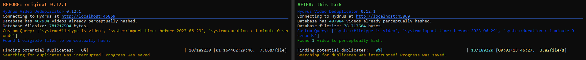

# Hydrus Video Deduplicator (faster fork)

<div align="center">



</div>

This is a fork of [Hydrus Video Deduplicator](https://github.com/hydrusvideodeduplicator/hydrus-video-deduplicator). It does the same job and gives the same results, faster.

- Every speed change gives identical hashes, search tree and potential duplicate pairs, and has a switch that
  restores the original code for that part.
- Everything that behaves differently (GPU decode, skipping repeat pair sends, search tree repair, backups, pruning
  deleted files) is opt-in and off by default.
- The database format is unchanged, so a database used by this fork still works with the original program.

It also adds `--relink-search-tree` to repair a damaged search tree, as reported in [issue #80](https://github.com/hydrusvideodeduplicator/hydrus-video-deduplicator/issues/80).

This fork was vibe-coded with AI assistance and tested on a Hydrus library of about 3.5M files, with about 410k
videos perceptually hashed. As in the original, videos include animated GIFs and APNGs.

The original README follows further down, from [Hydrus Video Deduplicator](#hydrus-video-deduplicator).

## Install this fork

The Windows exe on the original releases page and `pip install hydrusvideodeduplicator` both install the original
program, without these changes. To use this fork, install it from source. You need [Python](https://www.python.org/downloads/)
3.10 or newer and [Git](https://git-scm.com/downloads).

```sh
git clone https://github.com/micnorian14/hydrus-video-deduplicator.git
cd hydrus-video-deduplicator
python -m venv .venv
.venv\Scripts\activate          # Linux/macOS: source .venv/bin/activate
python -m pip install -e .
```

`gpu-decode` is this fork's default branch, so a plain clone gets it. For the GUI, also run
`python -m pip install -e ".[gui]"`.

Run it with `python -m hydrusvideodeduplicator` from the activated virtual environment, everywhere the original docs
say to run the exe. To update later, run `git pull` in the same folder.

## What's new in this fork

**Speed (identical results).** GPU video decoding, a faster check for already-hashed files at startup, downloading
the next file while the current one is hashed, an exact in-memory distance index and a shorter tree walk for
"Finding potential duplicates", faster search tree building, and Hydrus calls that run alongside the search. See
[Speed optimizations](#speed-optimizations-this-fork).

**Fixes.** `--relink-search-tree` repairs a damaged search tree in seconds ([issue #80](https://github.com/hydrusvideodeduplicator/hydrus-video-deduplicator/issues/80)). Error and
"broken branch" messages no longer break the progress bar. Full-width lines keep their line break in the Windows
console.

**Console output.** Colored `Tip:`, `WARNING:` and `ERROR` labels with plain text after them, progress bars capped
at 110 columns with colored stats and a steadier speed/ETA, one green completion line per stage with correct
plurals, speed tips at the start of the duplicate search, a warning at startup about clearing potential duplicates in
Hydrus, and a shorter `--help`. Printed paths show `%LOCALAPPDATA%`, `%USERPROFILE%` or `~` instead of your user
folder, so screenshots don't show your user name.

**GUI.** New **Back Up Database** and **Prune Deleted Files** buttons. GPU decode can be turned on with the
`GPU_DECODE=1` environment variable.

## Speed optimizations (this fork)

These are on by default. Each gives identical results, and setting it to `0` restores the original upstream code for
that part. You only need them if you want to compare against the original or rule one out while troubleshooting.

Set environment variables before running: in a `.bat` file add a line like `set HVD_PIPELINE=0` before the command,
or in a Linux/macOS shell run `HVD_PIPELINE=0 python -m hydrusvideodeduplicator ...`.

| Switch | Default | What it does | What `0` restores |
|---|---|---|---|
| `HVD_FAST_SEARCH` | `1` (on) | Exact in-memory distance index for "Finding potential duplicates". Falls back automatically if it can't be used. | Original distance calculation (also turns off `HVD_SCAN_SEARCH`). |
| `HVD_SCAN_SEARCH` | `1` (on) | Skips the part of the search tree walk that is the same for every file. | Original tree walk. |
| `HVD_PIPELINE` | `1` (on) | Searches the next files while Hydrus handles the current file's pairs (same calls, same order). | Original one-file-at-a-time loop. |
| `HVD_FAST_INSERT` | `1` (on) | Faster "Building search tree", identical tree. | Original tree inserts. |

Always on, with no switch (no effect on results or saved data): the next file is downloaded while the current one
is hashed, a faster check for already-hashed files, and a smoother progress bar speed/ETA.

### Speed tips for "Finding potential duplicates"

This step is limited by Hydrus's database. The fewer jobs Hydrus has queued, the faster this phase runs:

- Close any Hydrus duplicates pages (they recount pairs as they arrive).
- Pause duplicate auto-resolution rules.
- Pause Hydrus idle/background maintenance.
- Pause active downloads and subscriptions.

The program prints these tips at the start of the step. It also prints this warning once at startup, after the
database filesize line:

> ⚠️ **WARNING**: If you clear or resync potential duplicates in Hydrus (**"delete all potential duplicate pairs and re-search"** or **"resync potential duplicate pairs to storage"**), you will have to clear this tool's search cache (`--clear-search-cache`) and re-search every video from zero, which can take DAYS on a large library.

## New flags

All new flags are off by default. Add them to the command you already use, for example
`python -m hydrusvideodeduplicator --api-key="YOUR_API_KEY" --skip-repeat-pairs --prune-deleted-files`.
More on running the program is in [Usage](./docs/usage.md).

| Flag | Use it when |
|---|---|
| [`--gpu-decode`](#--gpu-decode) | You have an NVIDIA GPU and want hashing to use it for video decoding. |
| [`--skip-repeat-pairs`](#--skip-repeat-pairs) | You want fewer Hydrus API calls while finding potential duplicates. |
| [`--relink-search-tree`](#--relink-search-tree) | Once, to repair a damaged search tree. |
| [`--backup`](#--backup) | You want a copy of the dedupe database before each run changes it. |
| [`--prune-deleted-files`](#--prune-deleted-files) | You delete videos in Hydrus and want them out of the dedupe database. |

### `--gpu-decode`

Decodes videos on an NVIDIA GPU (CUDA/NVDEC) while perceptually hashing, instead of on the CPU. Decoded frames stay
in GPU memory and only the frames that get hashed are copied back. The hashes are identical to CPU decoding. If a
video can't be decoded on the GPU, a warning is logged and that video is hashed on the CPU.

```sh
python -m hydrusvideodeduplicator --api-key="YOUR_API_KEY" --gpu-decode
```

- Needs an NVIDIA GPU and driver, and a PyAV build with CUDA decoding. The PyAV wheel that `pip install -e .` installs
  on Windows includes it (tested with PyAV 19.0.2). To check, run
  `python -c "import av.codec.hwaccel as h; print(h.hwdevices_available())"` and look for `cuda` in the list.
- AMD and Intel GPUs are not used; leave the flag off on those systems.
- Only the hashing step uses it. It doesn't speed up "Finding potential duplicates".
- You can also set the environment variable `GPU_DECODE=1`. The GUI ignores command line flags, so use
  `GPU_DECODE=1` there.

### `--skip-repeat-pairs`

Most potential duplicate pairs are found twice during the search, once from each file's side, and by default each
time is sent to Hydrus. Hydrus stores the pair the same way both times, so the second send changes nothing. With
`--skip-repeat-pairs` (or the environment variable `HVD_SKIP_REPEAT_PAIRS=1`), each pair is sent only once per run,
which cuts the number of Hydrus API calls while finding potential duplicates.

```sh
python -m hydrusvideodeduplicator --api-key="YOUR_API_KEY" --skip-repeat-pairs
```

- A pair is skipped only if that exact pair was already sent successfully earlier in the same run. The list is kept
  in memory only.
- Nothing is saved differently: the dedupe database is not changed, and Hydrus ends up with the same pairs.
- Downloads, subscriptions and duplicate auto-resolution can keep running in Hydrus while it runs.
- **Caveat:** don't clear or resync potential duplicates in Hydrus during the run. A pair that was already sent this
  run would not be sent again. See the warning above.

### `--relink-search-tree`

A one-time repair for a damaged search tree ([issue #80](https://github.com/hydrusvideodeduplicator/hydrus-video-deduplicator/issues/80)), for example when the program reports a
broken branch in the search tree. It links every perceptual hash that belongs to a valid file into one valid search
tree, which takes seconds and re-hashes nothing. Then it clears the search cache, so the next duplicate search checks
every file again. That search can take a long time on a big database, and can be stopped and resumed.

```sh
python -m hydrusvideodeduplicator --api-key="YOUR_API_KEY" --relink-search-tree --backup
```

- Add `--backup` (as above) so you have a copy from before the repair.
- **Remove it from your script after the first run.** Each run with this flag resets the search cache again, so a
  restart would start the search from zero instead of resuming.
- Can't be combined with `--clear-search-tree`.
- Broken database rows are skipped and reported; nothing else is deleted.

### `--backup`

Copies the dedupe database before the run changes it (before any database upgrade), into the same folder as the
database, named `videohashes.backup-YYYYMMDD-HHMMSS.sqlite`. The copy is made with SQLite's own backup method, so it
is consistent.

```sh
python -m hydrusvideodeduplicator --api-key="YOUR_API_KEY" --backup
```

- The 3 newest backups are kept. Older files with that name pattern are deleted; no other files are touched.
- Each backup is the full size of the database, so 3 backups take about 3 times its size.
- Nothing happens if there is no database yet.
- To restore, close the program and copy a backup over `videohashes.sqlite`.
- In the GUI this is the **Back Up Database** button.

### `--prune-deleted-files`

The dedupe database keeps every video it ever hashed, even after you delete the video in Hydrus. Those videos stay
in the search tree, can still be matched against new videos (each match is a wasted Hydrus call), and are searched if
they had not been searched yet. `--prune-deleted-files` removes them.

```sh
python -m hydrusvideodeduplicator --api-key="YOUR_API_KEY" --prune-deleted-files
```

- It always makes a backup first (it turns on `--backup`, so you don't need both).
- It asks Hydrus once, read only, for every video, gif and apng in "all local files". This includes the trash and
  is not limited by `--query` or `--file-service-key`. Anything still in Hydrus is kept.
- Every hashed video Hydrus no longer has is removed from the database, the search cache and the queue of videos
  waiting to be added to the search tree. Perceptual hashes that no remaining video uses are removed from the search
  tree, and the tree is relinked around them so it stays valid. Nothing is re-hashed and remaining videos keep their
  search progress.
- It is all-or-nothing: on an error or CTRL+C the database is left unchanged. If Hydrus can't be reached or returns
  no videos, nothing is pruned and the run continues.
- It prints a summary like `Pruned 5912 deleted videos from the database and 5612 entries from the search tree.`,
  or `No deleted videos to prune.`
- It is safe to leave in your script: later runs only remove what you've deleted since the last run.
- The database file doesn't get smaller until you run **Run Database Maintenance** in the GUI.
- The database format does not change, so the pruned database still works with the original program.
- It runs at startup, before perceptual hashing. In the GUI this is the **Prune Deleted Files** button.

---

# Hydrus Video Deduplicator

<div align="center">


Hydrus Video Deduplicator finds potential duplicate videos through the Hydrus API and marks them as potential duplicates to allow manual filtering through the Hydrus Client GUI.

[](https://pypi.org/project/hydrusvideodeduplicator)
[](https://pypi.org/project/hydrusvideodeduplicator)
[](https://pypistats.org/packages/hydrusvideodeduplicator)
[](https://github.com/hydrusvideodeduplicator/hydrus-video-deduplicator/stargazers)

</div>

---

Hydrus Video Deduplicator **does not modify your files**. It only marks videos as `potential duplicates` through the Hydrus API so that you can filter them manually in the duplicates processing page.

[See the Hydrus documentation for how duplicates are managed in Hydrus](https://hydrusnetwork.github.io/hydrus/duplicates.html).

This program contains no telemetry. It only makes requests to the Hydrus API URL which you specify.

## [Installation](./docs/installation.md)

> **Note (this fork)**: The release downloads and the pip command below install the original program. To get this fork's changes, see [Install this fork](#install-this-fork).

For Windows and Linux, you can get the [latest release directly from the github releases page](https://github.com/hydrusvideodeduplicator/hydrus-video-deduplicator/releases).

For macos, see the [Python Install](#python-install).

> **Note**: Many instructions in this repo are written for the Python install instead of the Windows exe. If you're using the Windows exe, simply replace `python -m hydrusvideodeduplicator` with `hydrusvideodeduplicator-windows-x86_64.exe` and the instructions will work the same.

## [Usage](./docs/usage.md)

See [Usage](./docs/usage.md) for how to run the program, and [FAQ](./docs/faq.md) for more information.

## Python Install

> **Note (this fork)**: The pip command below installs the original program from PyPI. To get this fork's changes, including on Windows, see [Install this fork](#install-this-fork).

> **Note**: Windows users do not need the Python install. Download the exe as described in [Installation](#installation) instead.

### Dependencies

- [Python](https://www.python.org/downloads/) >=3.10

```sh
python -m pip install hydrusvideodeduplicator
```

Then continue to [Usage](./docs/usage.md).

---

## [Contact](./docs/contact.md)

Create an issue on GitHub for any problems/concerns. Provide as much detail as possible in your issue.

Email `hydrusvideodeduplicator@gmail.com` for other general questions/concerns.

Message `@applenanner` on the [Hydrus Discord](https://discord.gg/wPHPCUZ) for other general questions/concerns.
